## Neuroinformatics Unit{.smaller}

::: {.columns}
::: {.column width="40%"}
- Sainsbury Wellcome Centre & Gatsby Computational Neuroscience Unit, UCL

:::{.fragment}
- (Systems) neuroscience & machine learning **research software engineering** group
:::
:::{.fragment}
- Build sustainable, general-purpose software infrastructure for the neuroscience community

:::

:::
::: {.column width="60%"}
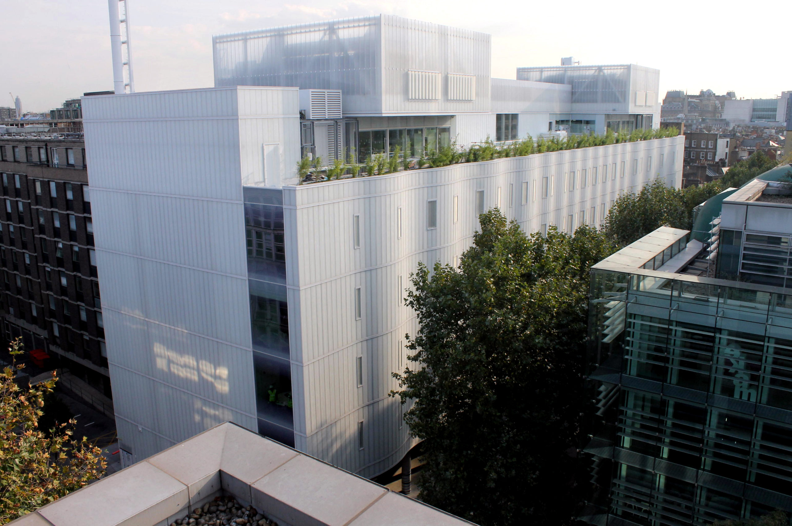
:::
:::

## Team {.smaller}

```{=html}
<style>
.reveal .team figcaption { text-align: center; }
</style>
```

::: {.team layout-nrow=2}

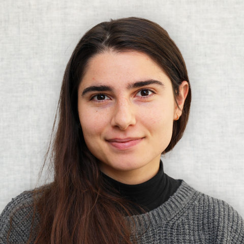

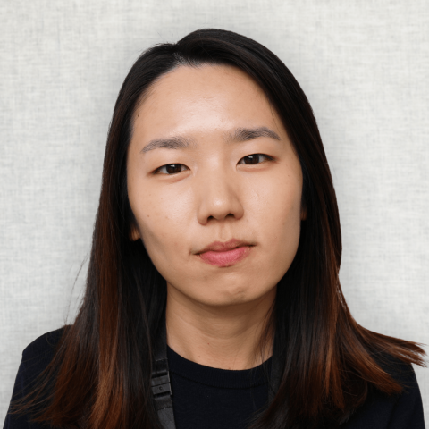


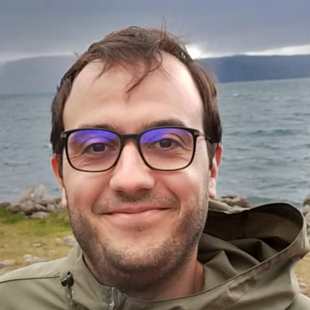

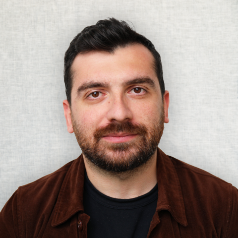

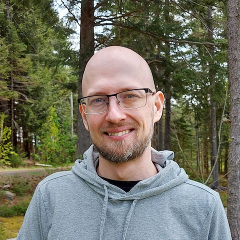

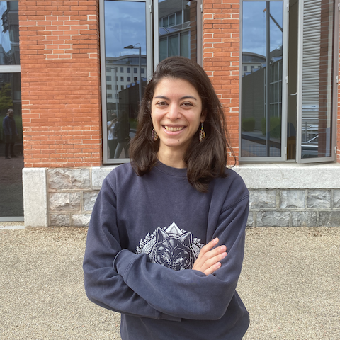

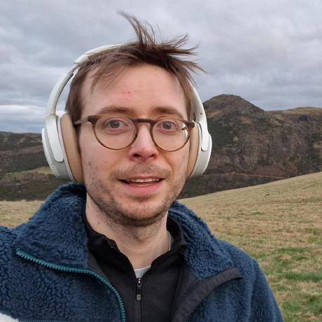

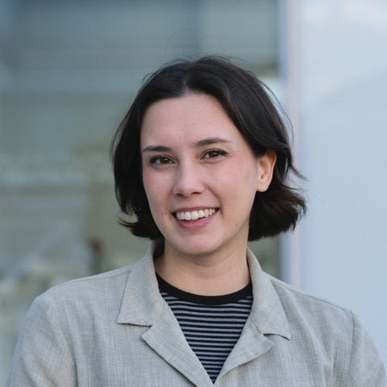


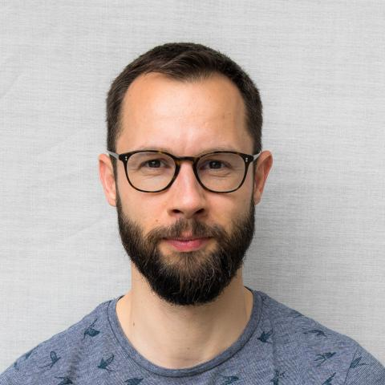

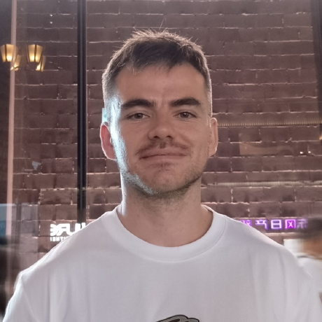

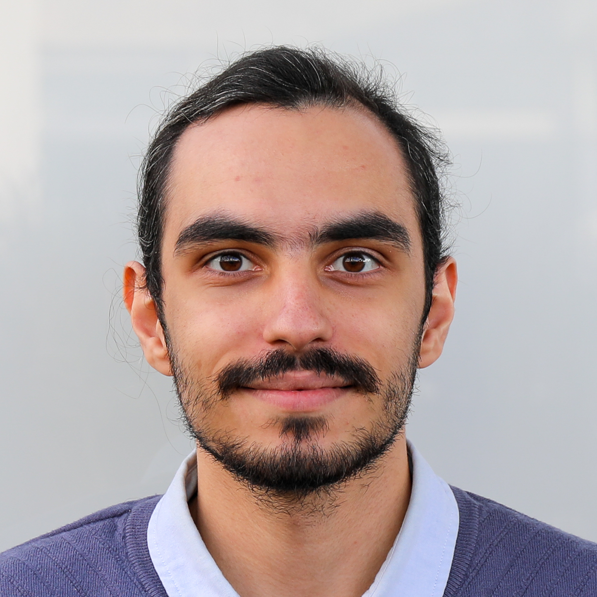

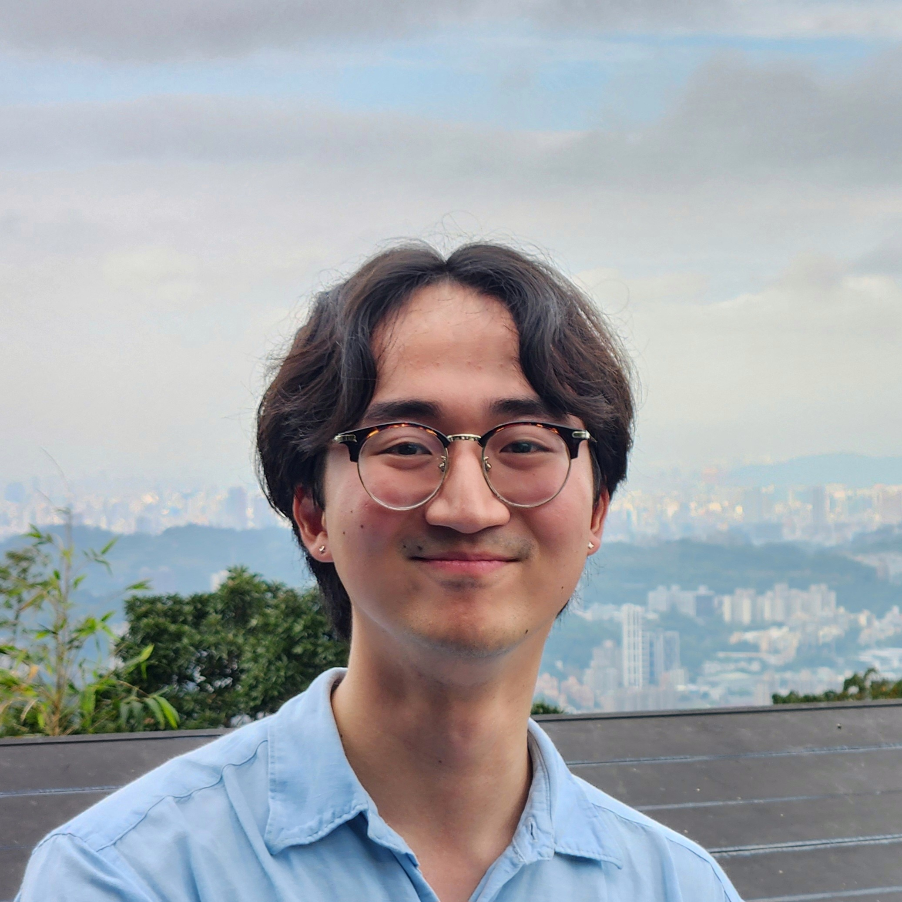

:::

## What we do
:::{.incremental}
- **Data analysis software** (anatomy, electrophysiology, functional imaging, behaviour)
- **Data management** (specifications, tools)
- **Collaborations** (data science, software development, productionisation)
- **Open source contributions** (community tools, infrastructure)
:::

# ARC collaborations

## {.smaller}

* **#495 - BrainGlobe napari plugins** (David Stansby, Paddy Roddy, David Pérez-Suárez, Alessandro Felder)

* **#686 - Improving BrainGlobe's sustainability** (David Stansby, Alessandro Felder, Will Graham, Sofia Miñano, Kimberly Meechan, Stella Prins, Miguel Xochicale)

* **#745 - Crab tracking** (Sofia Miñano, Nik Khadijah Nik Aznan, Sam Cunliffe)

* **#1270 - expanding movement features** (Stella Prins, Will Graham)

* **#1413 - Database management** (Mahmoud Abdelrazek,  Socrates Varakliotis)

* **#1495 - Productionising BrainGlobe Template Builder** (Kimberly Meechan, Stella Prins)

* **#1601 - Productionising OSCaR** (Kimberly Meechan, Henry Crosswell, Tom Couch)

* **#1926 - Making brain connectivity data accessible** (Stella Prins, Kimberly Meechan, Will Graham)


# Why we like working with ARC

# Capacity (get stuff done faster)


## #1495 - Productionising BrainGlobe Template Builder

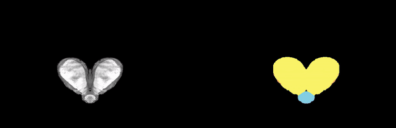{fig-align="center"}

::: {.absolute right="0%" bottom="0%" style="text-align: right; font-size: 0.5em;"}
 Sirmpilatze, Felder & Abdulazhanova et al. (2026), Cell Reports
:::

::: footer
[brainglobe.info/brainglobe-template-builder](https://brainglobe.info/brainglobe-template-builder/index.html)
:::

## #1495 - Productionising BrainGlobe Template Builder

* Simplify workflow
* Reduce duplication of code
* Remove difficult dependencies
* Improve quality control plots
* Improve graphical user interface
* Improve logging
* Improve documentation

::: {.absolute right="0%" bottom="0%" style="text-align: right; font-size: 0.5em;"}
 Kimberly Meechan, Stella Prins
:::

::: footer
[brainglobe.info/brainglobe-template-builder](https://brainglobe.info/brainglobe-template-builder/index.html)
:::


# Knowledge (do things we can't)

## #1413 - Database management

* Large SWC project uses DataJoint databases
* Support bought in externally
* Bring it in-house

## #1413 - Database management

* Replicate database on SWC infrastructure
* Containerise
* Document deployment
* Next: run pipelines on HPC

::: {.absolute right="0%" bottom="0%" style="text-align: right; font-size: 0.5em;"}
Mahmoud Abdelrazek, Socrates Varakliotis
:::


# Flexibility (avoid short-term contracts)
 
## #1270 - expanding movement features
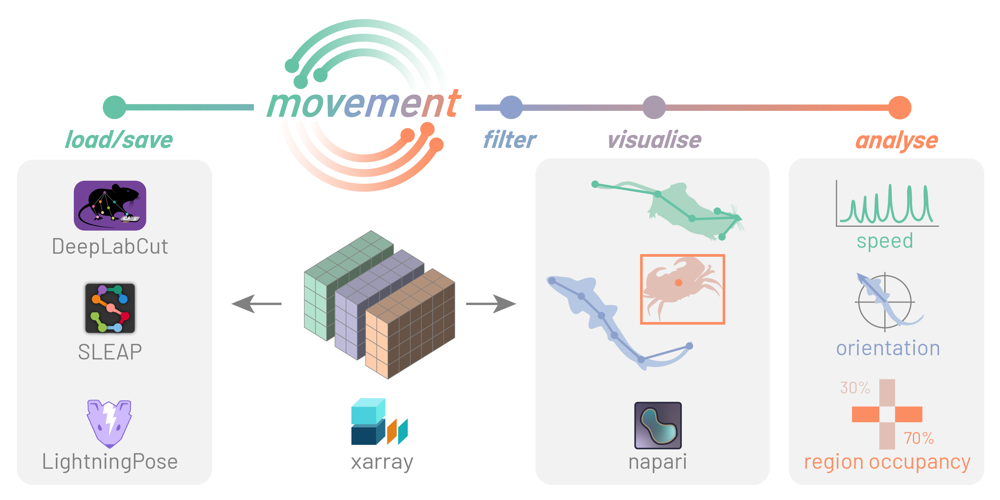{height=400}

::: {.absolute right="0%" bottom="0%" style="text-align: right; font-size: 0.5em;"}
Niko Sirmpilatze
:::

::: footer
[movement.neuroinformatics.dev](https://movement.neuroinformatics.dev/)
:::

## #1270 - expanding movement features

* Define spatial regions of interest
* Streamlining plotting
* Create new example use cases

::: {.absolute right="0%" bottom="0%" style="text-align: right; font-size: 0.5em;"}
Stella Prins, Will Graham
:::

# Continuity (knowledge stays at UCL)

## #1601 - Productionising OSCaR
Open-Source Colony assessment Resource (OSCaR)

* Predict animal breeding
* Reduce waste (ethics, cost etc.)
* Excel sheet, entirely manual
* Needs to integrate with colony management

## #1601 - Productionising OSCaR

:::: {.columns}
::: {.column width="45%"}
- Python API
- Django frontend
- Deployed via AWS

:::
::: {.column width="55%"}
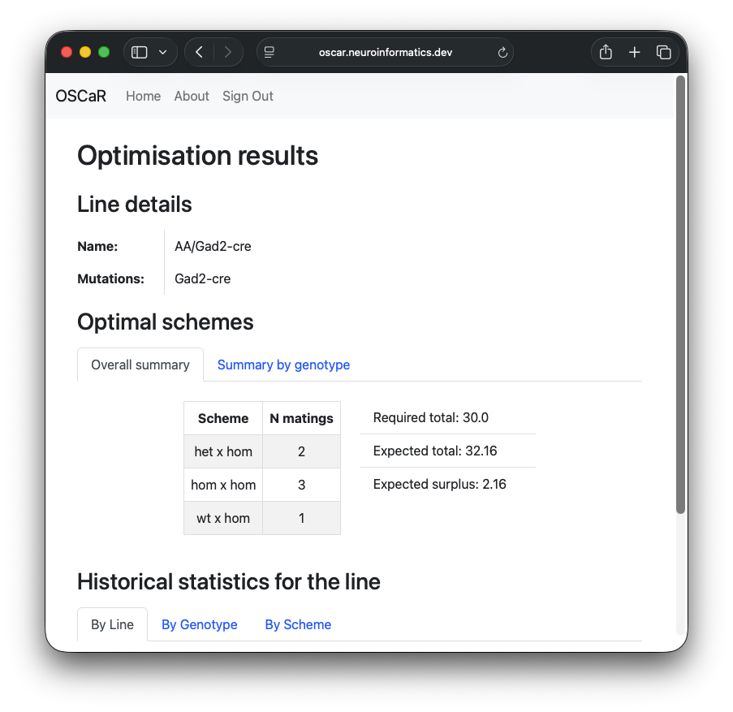{fig-align=left}
:::
::::

## #1926 - Making brain connectivity data accessible 
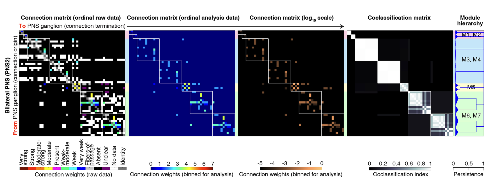{height=450}

::: {.absolute right="0%" bottom="0%" style="text-align: right; font-size: 0.5em;"}
Swanson et al. (2025), PNAS
:::


## #1926 - Making brain connectivity data accessible 

:::: {.columns}
::: {.column width="45%"}
- Python API
- Django frontend
- Deployed via AWS

:::
::: {.column width="55%"}
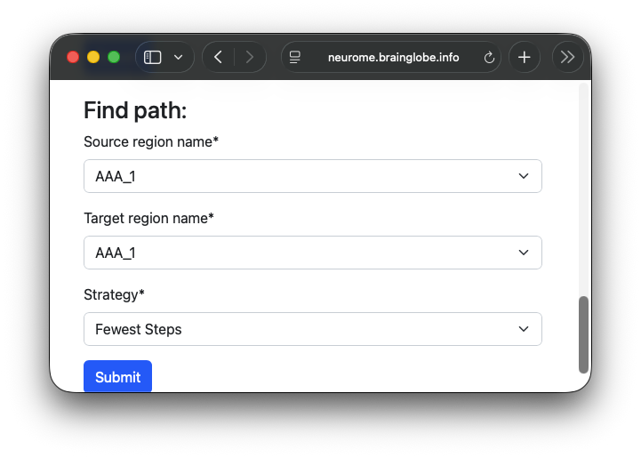{fig-align=left}
:::
::::

::: {.absolute right="0%" bottom="0%" style="text-align: right; font-size: 0.5em;"}
Stella Prins, Kimberly Meechan, Will Graham
:::

::: footer
[neurome.brainglobe.info](https://neurome.brainglobe.info)
:::


# Future collaboration

## Neuroscience at UCL

* 1/3 of university's research income
* Relatively disjointed
* Labs "reinventing the wheel"


## NIU & ARC {.smaller}

|                       | NIU                                                 | ARC                                   |
|-----------------------|-----------------------------------------------------|---------------------------------------|
| **Team**              | Small                                               | Large                                 |
| **Tech stack**        | Narrow                                              | Broad                                 |
| **Funding**           | Grant & dept                                        | More sustainable                      |
| **Neuroscience** | Maintain >30 widely used packages           | Relatively few neuroscience projects  |


## Future collaboration
Is there a more coherent way for NIU & ARC to offer services to the (huge) UCL neuroscience community?


# Thanks

## Support

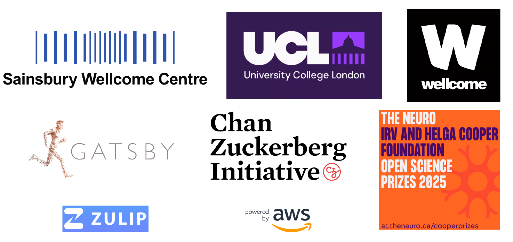{fig-align="center"}


## Contributors

::: {style="font-size: 45%;"}

Adrien Berchet, Mathieu Bourdenx, bkntr, NovaFae, David Young, Sam Clothier, Gubra-ApS, Kailyn Fields, ramroomh, Samuel Diebolt, Chris Roat, Oren Amsalem, kclamar, Draga Doncila Pop, juanma9613, Jules Scholler, Iaroslavna Vasylieva, Nicolas Peschke, Justin Kiggins, Peter Sobolewski, Simão Bolota, chili-chiu, jaimergp, Sebastian Lammers, Matt Colligan, Paul Brodersen, Carter Peene, francesshei, Sean Martin, Ben Dichter, 4iar, Marco Musy, Anna Medyukhina, stegiopast, EmanPaoli, lidakanari, Alexis Arnaudon, Ziyang Liu, Will Graham, Patrick Roddy, Philip Shamash, Christian Niedworok, Charly Rousseau, Horst Obenhaus, Chryssanthi Tsitoura, Sepiedeh Keshavarzi, Mateo Vélez-Fort, Stephen Lenzi, Rob Campbell, Alessandro Felder, Federico Claudi, Luigi Petrucco, Adam Tyson, Troy Margrie, Tiago Branco, Ruben Portugues, Joe Ziminski, Sofia Miñano, Niko Sirmpilatze, Nicholas Del Grosso, Laura Porta, Lee Cossell, Antonin Blot, David Pérez-Suárez, David Stansby,  koushik-ms, Harald Reingruber, Emily Jane Dennis, Peak, Maximilian Blacher, Hernando Martinez Vergara, Estelle, nicole-vissers, GD, Michael Kunst, Estelle Nassar, Sara Mederos, Igor Tatarnikov, Viktor Plattner, Carlo Castoldi, Jingjie Li, Guillaume Le Goc, Harry Carey, Matt Einhorn, Kimberly Meechan, Robert Kozol, Roberto, Axel Bisi, Jung Woo Kim, Saima Abdus, Saarah Hussain, Sacha Hadaway-Andreae, Presa, Henry Crosswell, Nischit Kumar, Kirato Yoshihara, Leonard Schwigon, Dinora Abdulazhanova, Katrin Haase, Dominik Heyers, Isabelle Museliak, Henrik Mouritsen, Simon Weiler, Stella Prins, Richard Dushime, Miguel Xochicale, M S P, Abdul Samad, Prisha Sharma, Farida Yusuf, Anshu Saini, Menna1812, ayush2281, BethCr, Swapnaneel Patra, Xiaoyu Deng, DwarvesEatRocks, DPWebster, Conrad, pranav33317, Biswanath Saha, Federico F, Tim Monko, Kaixiang Shuai, Giulia Paci, Marco Dalla Vecchia, Pavel Vychyk, Ishrat Zaman, Fatma S. Elsharkawy, Chang Huan Lo, Pascal Malkemper, Alireza Saeedi, Nasibeh Amini, Aref hossein Akhlaghi, Li Zhang, Leoni-Marie Webb, Nishanth B, Ardavan Shahrabi, Varun Singh, Harshdip Saha, sid-42-d, James Rowland, Kavyashah067, Aditya Gupta, Luigi Meola, Ajitesh Kumar Singh, Chandrika, Hargun Kaur, Rahul Bera, Hashbrownsss, Divyansh Gupta, Yaroslav Halchenko, Bhanushali Parth Hitesh, Harsh Bhanushali, Tushar Verma, maxstaras, Akseli Ilmanen, Lakshmi Sowmya, Sparshr04, Shigraf Salik, Vedant Vakharia, ishan372or, Holly Morley, Parth Chatupale, Shreecharana N, Eric Denovellis,  Iván Varela, Vaco Schiavo, Laura Schwarz, Mohamed Reda, Mikkel Roald-Arbøl, Sanjana Soni, vybhav72954, Kasra Shirvanian, Kunal Dadlani, Dhruv Yadav, angkul07, Eduardo Augusto, CeliaLrt, Animesh Sasan, Tushar Das, Dhruv Sharma, Ishaan Shaikh, Brandon Peri, Shrey Singh, Damacharla Sushma, Sumana Sree Angajala,  Shreejan Dolai, Aryan Srivastava, Alexandro Berumen, Alessio Buccino, Arielle Leon, Sergio Valbuena, Matthew Scroggs, kawaho4, Andrew Moffitt, Ankush Agarwal
:::
